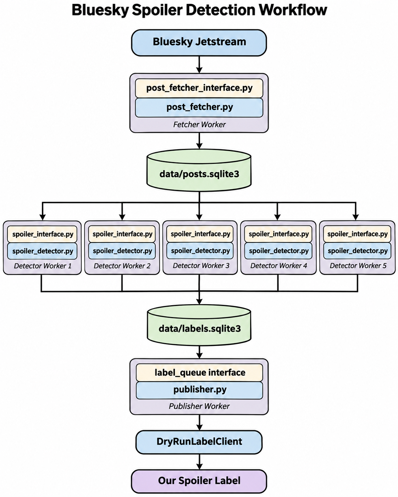

# Bluesky Spoiler Detection

First-pass implementation of the queue-based pipeline described in
[`architecture.md`](architecture.md):

```text
reader -> SQLite post queue -> detector workers -> SQLite label queue -> publishers
```



The live reader connects to Bluesky's public Jetstream JSON WebSocket and asks
the server for `app.bsky.feed.post` events only. JSON Lines replay remains
available for development, and the publisher is deliberately dry-run-only until
a real AT Protocol labeling client and credentials are configured.

## Try the pipeline locally

Install the Python package and all development/test dependencies:

```shell
python -m pip install -r requirements.txt
```

The live metrics tunnel also uses the external `cloudflared` executable; see
the platform-specific installation note below.

Create a sample event:

```json
{"kind":"commit","seq":1,"did":"did:plc:example","commit":{"operation":"create","collection":"app.bsky.feed.post","rkey":"example","cid":"bafyexample","record":{"text":"This contains a spoiler","createdAt":"2026-01-01T00:00:00Z"}}}
```

Save it as `event.jsonl`, then start the entire pipeline with one command:

```shell
python coordinator.py --input event.jsonl
```

The `--input` argument is optional and exists only for replaying a development
JSON Lines file. The normal live command is simply:

```shell
python coordinator.py
```

That command makes the reader connect to the endpoint in
`config/pipeline.json` without requiring a placeholder file value. For a
bounded live smoke test that drains both queues and exits:

```shell
python coordinator.py --max-events 100
```

The coordinator starts the configured reader, detector workers, publisher
workers, and live metrics gateway. When a finite input file reaches EOF, it waits
for both queues to drain and shuts the remaining components down. Without
`--input`, the reader consumes the live Jetstream connection and resumes from
the cursor stored in the post database after a reconnect or restart.

Worker counts, database locations, metrics settings, restart limits, and the
temporary dry-run publisher setting live in `config/pipeline.json`. Stop the
whole process group with `Ctrl-C`; individual failed workers are restarted up
to the configured limit.

Configure GitHub Pages to publish from `docs/`. The dashboard remains a static
site, but its JavaScript discovers the active coordinator and reads live
snapshots from its metrics gateway once per second. The coordinator binds a
loopback-only HTTP server, starts an outbound Cloudflare Quick Tunnel, and
registers that temporary HTTPS URL on the `live-metrics-endpoint-registry`
branch. Metric
values are never committed to GitHub and do not cause Pages deployments.

Install `cloudflared` once on each machine that may run the coordinator. On
macOS with Homebrew:

```shell
brew install cloudflared
```

Quick Tunnels require no Cloudflare account, public IP address, router port
forward, or inbound firewall rule. The coordinator owns the tunnel process and
closes it during shutdown.

The repository includes `.github/workflows/deploy-pages.yml`. It validates and
deploys `docs/` only when frontend files change on `main`; metrics-only commits
do not trigger a deployment. In the repository's **Settings → Pages**, select
**GitHub Actions** as the publishing source. You can validate the artifact
locally before pushing:

```shell
bash scripts/prepare-pages.sh
```

If the published site displays this repository README, GitHub Pages is still
using **Deploy from a branch** and publishing the repository root. Change the
Pages source to **GitHub Actions**. A root `index.html` redirect is included as
a fallback, but the Actions source is the intended deployment mode.

For this demo, the fine-grained GitHub token is embedded directly in the
metrics gateway. The repository, endpoint registry, local port, allowed
browser origin, and rate window are configured in `config/pipeline.json`:

```json
"metrics": {
  "repository": "CSE210-Team05/Bluesky-SpoilerDetection",
  "registry_branch": "live-metrics-endpoint-registry",
  "registry_path": "docs/metrics-endpoint.json",
  "host": "127.0.0.1",
  "port": 8765,
  "live_rate_window_seconds": 10,
  "caught_up_lag_seconds": 10,
  "allowed_origin": "https://cse210-team05.github.io"
}
```

Dashboard throughput uses counter deltas over a short ten-second in-memory
window. The persistent five-minute SQLite buckets remain available for coarse
history, but no longer make the live display take minutes to reflect recovery
or a change in incoming demand.

Reader health is independent of throughput. Jetstream's `time_us` cursor is
stored with stream health, and the dashboard reports **Up to date** when the
reader is connected and the newest source event is no more than ten seconds
behind wall-clock time. A low rate with an up-to-date cursor means current
demand is low; **Catching up** means the reader is still consuming older events.

The OS socket bind rejects a second gateway on the same host. A SHA-guarded
registry lease rejects a coordinator from another installation if one is
already active. The local installation ID is stored beside the post database,
so this installation automatically reclaims its own lease after an ungraceful
exit. After upgrading from a version that used a new random ID on every run,
verify the old process has stopped and use
`python coordinator.py --force-metrics-lease` once to replace that legacy
lease.

## Test

```shell
python -m pytest
```

## Current boundaries

- `Bluesky_interface` owns the post database and stream cursor.
- `spoiler_interface` owns the label database.
- Detector workers receive logical items from `SpoilerWorkerInterface`; the
  pure `isSpoiler` function has no database or transaction knowledge.
- Label results are written through a bounded asynchronous sink, with positive
  source jobs acknowledged only after their label is durable.
- Worker leases expire and are redelivered after crashes.
- Queue IDs and label IDs are deterministic, making repeated queue insertion
  idempotent. A live publishing client must also use the job ID as its
  idempotency key where the labeling service supports one.
- The SQLite databases must live on a local disk, not a network filesystem.
- The detector is currently in throughput mode and returns positive immediately
  for every post. The keyword implementation remains present but bypassed.
- Live Bluesky label publication remains an explicit integration task.
